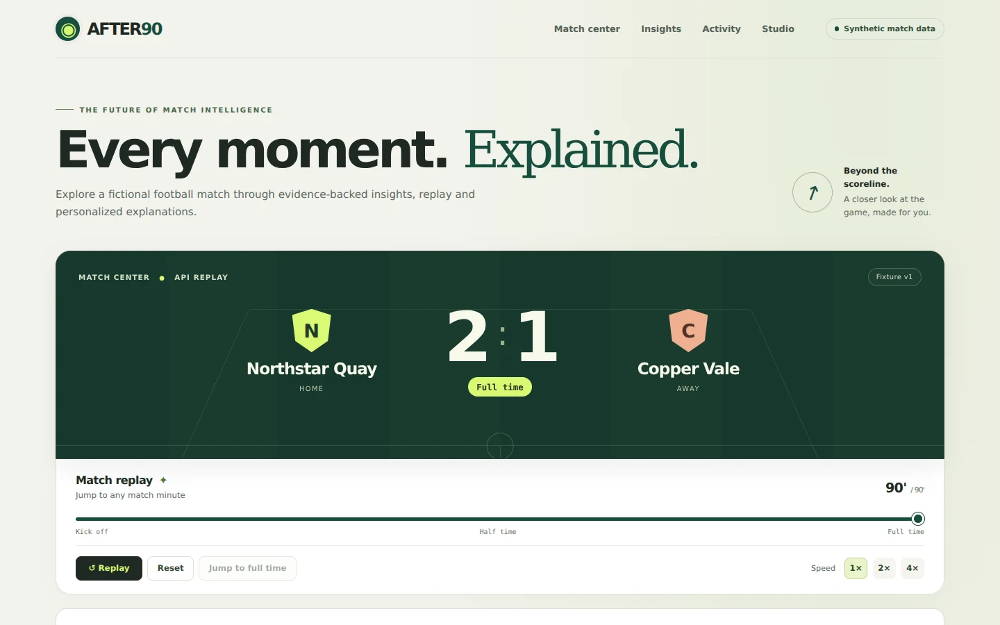

# After90

### Understand the moment. Inspect the evidence.

After90 turns **synthetic football events** into explainable match intelligence for fans, analysts and studio teams. Replay a fictional match, discover the moments that changed its story, switch between plain-language and detailed explanations, and inspect the events behind every claim.

Built for **Inside the Game: Developer Hackathon — The Synthetic Match Insights Engine for Premier League Studio**.

**Synthetic match data:** every match, club, player and event shown is fictional. After90 does not redistribute real Premier League match data or use an official match feed.



[Source repository](https://github.com/VIKSIT-GARG/after90) · [Technical specification](docs/TECHNICAL_SPEC.md) · [Submission package](docs/SUBMISSION_PACKAGE.md) · [AI audit](docs/AI_AUDIT.md)

## The problem

A scoreline tells viewers what happened, but a number alone rarely explains its significance. Casual fans need a clear story; analysts need the comparison, time window and supporting evidence. Studio teams need a concise output they can place alongside the match.

After90 gives these audiences different views of the **same verified facts**. Its evidence-first pipeline prevents a compelling explanation from becoming an invented football claim.

## What you can do

- **Replay and investigate:** play, pause, change speed, reset or seek any minute of a deterministic 90-minute match. The dashboard uses the backend fixture throughout.
- **See contextual moments:** opening goals, equalizers, lead changes, shot surges and possession swings carry their recorded context and supporting event references.
- **Choose your audience:** Fan mode keeps explanations concise; Analyst mode exposes exact facts, comparisons, windows and limitations.
- **Explore match activity:** select five-minute intervals, compare an event-weighted activity index and inspect the recorded events. The index is explicitly not xG or a prediction.
- **Follow the story to full time:** recaps retain decisive goals and supported non-goal patterns, including in high-scoring fixtures.
- **Preview a studio graphic:** a synchronized, timestamped overlay presents a compact headline and stat line with source and evidence metadata.
- **Keep working through failures:** clearly labelled templates preserve the experience when Foundry is unconfigured, unavailable, times out or returns an invalid selection.

The golden fixture contains **225 synthetic events**. Northstar Quay beat Copper Vale **2–1**, with goals at **29, 62 and 78 minutes**. Scores and statistics are computed from these events, never supplied by a model.

## One pipeline, five stages

| Stage | After90 implementation |
| --- | --- |
| **Ingest** | Load a versioned, validated synthetic fixture and expose only events available at the selected replay minute. |
| **Interpret** | Calculate scores, shots, passes and timed possession; detect supported moments and build a story ledger. |
| **Explain** | Construct canonical evidence packets. An optional Foundry planner selects approved facts, interpretations and audience frames; code renders factual wording. |
| **Render** | Display the match dashboard, evidence panels, recaps and structured studio graphic preview. |
| **Personalize** | Render Fan and Analyst experiences from the same underlying evidence. Optional team-priority ordering is available behind a disabled-by-default build flag. |

Possession is qualified when evidence is unavailable. Replay cutoffs apply to explanations, stories and overlays, so a cached future insight cannot leak into an earlier minute.

## AI design and Microsoft technologies

**After90 is Foundry-ready; live Foundry operation has not yet been verified.** The current working demo can run entirely with its labelled evidence-based fallback.

The model's responsibility is deliberately bounded: select evidence and approved narrative frames, rather than invent match statistics or unrestricted prose. The server validates that selection, renders the exact factual sentences and returns canonical evidence separately. A `foundry` source means **AI-selected, server-rendered narrative**; a `template` source means deterministic fallback.

| Technology | Role and current status |
| --- | --- |
| **Microsoft Foundry Responses API** | Backend structured-selection adapter, validation and telemetry implemented. Real endpoint/model access and live all-type acceptance remain unverified. |
| **Azure Container Apps** | Container, deployment template and release tooling prepared. A public Azure deployment has not been verified. |
| **Python + FastAPI + Pydantic** | Deterministic engine, fixture validation, replay-safe API and narrative service. |
| **React + TypeScript + Vite** | Responsive replay dashboard, audience modes, evidence and studio preview. |
| **GitHub Actions, pytest, Playwright and axe** | Backend, frontend, container, evaluation and browser/accessibility checks. |

Provider requests have a total deadline, bounded response size, endpoint restrictions and sanitized optional usage/model/attempt metadata. Versioned single-flight caches, concurrency limits and replenishing per-process request budgets protect the service. These application limits are not a global Azure spending cap. Model credentials stay on the backend.

There is no claim of runtime multi-agent orchestration, live broadcast integration, video event detection or production streaming ingestion. The implemented experience replays synthetic events. Player-focused mode and multilingual storytelling remain future work.

## Run locally

**Requirements:** Python 3.11+, Node.js 22+ and npm. Clone the repository, then:

```sh
git clone https://github.com/VIKSIT-GARG/after90.git
cd after90
bash run.sh
```

Open **http://127.0.0.1:8000**. The script creates the Python environment, installs dependencies, builds the frontend and serves the page and API together. Interactive API documentation is at **http://127.0.0.1:8000/docs**.

No Foundry credentials are required for local replay or labelled template explanations.

### Optional Foundry configuration

```sh
cp .env.example .env
```

Set `FOUNDRY_RESPONSES_URL`, `FOUNDRY_MODEL` and `FOUNDRY_API_KEY` privately in `.env`, then run `bash run.sh`. The startup wrapper explicitly loads the file without overriding existing process variables. Never commit a populated `.env`; use hosting secrets for a deployed application.

See [AI access and readiness](docs/AI_ACCESS.md) for accepted endpoint shapes, environment precedence and safe live checks. Direct script invocations use their process environment; the explicit environment wrapper below loads `.env`:

```sh
.venv/bin/python -m backend.matchlens.env --run .venv/bin/python scripts/check_ai_readiness.py
```

### Development and Docker

With Make installed, run `make setup`, then `make backend` and `make frontend` in separate terminals. Open http://localhost:5173; Vite proxies `/api` to port 8000. Use `bash run.sh` for the explicit `.env` startup flow.

```sh
docker build -t after90:local .
docker run --rm -p 127.0.0.1:8000:8000 after90:local
```

The Docker build serves the frontend and API together. For cloud deployment, follow the [Azure release runbook](docs/AZURE_RELEASE.md); deployment is a separate account-authorized action.

## Try the demo

1. Start the match, then seek to minute **28** to inspect the recorded shot-surge evidence.
2. At **29**, open the goal insight to see why the score transition matters.
3. Switch from **Fan** to **Analyst** and inspect the exact facts and event references.
4. Select a match-activity interval and review its events; inspect the studio graphic preview.
5. Jump to **62** for the equalizer, **78** for the winning goal and **90** for the full-time recap.
6. Check the explanation source indicator. A template badge is fallback, not proof of a live model call.

## API overview

| Route | Purpose |
| --- | --- |
| `GET /api/health` | Health, synthetic fixture identity and non-secret AI/budget status. |
| `GET /api/matches/demo?minute=29` | Event-derived snapshot at minute 0–90. |
| `GET /api/matches/demo/insights/{id}?mode=fan&as_of_minute=29` | Explained insight available at the requested replay cutoff. |
| `GET /api/matches/demo/story?minute=90` | Supported story moments available by that minute. |
| `GET /api/matches/demo/overlay?minute=29` | Structured studio graphic output, or no available overlay. |
| `GET /api/matches/demo/recap?mode=analyst&as_of_minute=90` | Full-time story, canonical final statistics and provenance. |

See [API v0.2 contracts](docs/API_V2.md) and the [AI contract](docs/AI_CONTRACT.md). Recaps require full time; future or unknown insights are rejected. Consumers must respect `possession_available=false` instead of displaying assumed raw percentages as measured data.

## Verification

The merged implementation passed **340 Python tests**, **13 frontend tests**, **60 offline corpus cases**, **8 integrated checks** and **13 direct offline contexts**, plus the production build. Real Chromium checks passed at desktop and 390/320-pixel widths, with zero reported accessibility violations in four checked states and zero runtime errors. These results establish the tested local behavior, not live model quality or an accessibility certification.

```sh
make setup
.venv/bin/python -m pytest -q
.venv/bin/python scripts/evaluate_ai.py
.venv/bin/python scripts/evaluate_integrated.py
.venv/bin/python scripts/evaluate_live_ai.py
npm test --prefix frontend
npm run build --prefix frontend
(cd frontend && npx playwright install --with-deps chromium)
.venv/bin/python scripts/test_browser.py
```

CI runs backend tests/evaluations, frontend tests/build, container smoke tests and real browser checks. Regression coverage includes sparse evidence, high-scoring recaps, long display names, stalled DNS, trickling responses, budget recovery and replay cutoffs.

### Remaining acceptance gates

- **AI-01 — Live operation:** supply private Foundry configuration and run uncached, all-type live evaluation. Injected clients and partial successes cannot pass this gate.
- **AI-02 — Editorial value:** compare representative live selections with the deterministic baseline using human ratings. Review IDs bind the exact text and evidence; textual differences alone do not prove usefulness.
- Verify public Azure hosting, permitted spend, quota and submission links in the team account before claiming a complete public release.

The [audit remediation register](docs/AI_AUDIT.md) records eight fixed code findings and these remaining acceptance items. [Evaluation instructions](docs/AI_EVALUATION.md) explain live reports and blinded review. No public demo or hosted video URL is claimed in this README until it is published and checked.

## Repository guide

| Directory | Contents |
| --- | --- |
| `frontend/` | React dashboard and frontend/browser checks. |
| `backend/matchlens/` | Fixture loading, statistics, insights, evidence, narratives, story, API and reliability controls. The internal package name is retained for compatibility. |
| `data/` | Versioned fictional match fixture and evaluation inputs. |
| `tests/` | Backend contracts, correctness and failure-recovery checks. |
| `scripts/` | Readiness, evaluation, browser, deployment and smoke-test tooling. |
| `infra/azure/` | Azure deployment template and example configuration. |
| `docs/` | Architecture, delivery plan, audit, release and submission materials. |

## Team and delivery

- **Billi:** backend foundation, synthetic fixture, statistics, insight detection and technical integration.
- **Ayesha:** frontend experience and responsive match dashboard.
- **Maryam:** AI explanation/recap design, Foundry integration and wording safeguards.
- **Zoya:** quality checks, deployment, documentation and demo/submission production.

See [workstreams](docs/WORKSTREAMS.md), [implementation status](docs/IMPLEMENTATION_STATUS.md), [remediation phases](docs/AI_FIX_PLAN.md) and [release gates](docs/RELEASE_GATES.md) for ownership, completed work and remaining dependencies.
