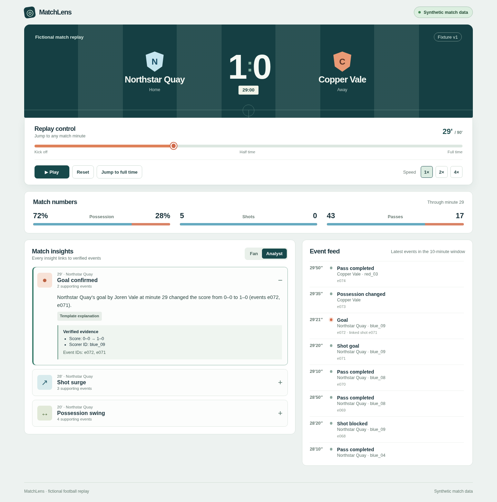

# After90

After90 is a replayable companion for a **fictional football match**. It derives scores, statistics, and insight evidence from 225 synthetic events, then explains moments in Fan or Analyst mode. The final recap uses the same verified match facts. Every match view is labeled **Synthetic match data**.

**Build status:** The replay, bounded narrative API, personalized Fan/Analyst views,
evidence, story recap, studio graphic preview, recovery/cache controls and local
evaluation are implemented. Azure deployment tooling and submission materials
are prepared. Real Foundry access, public Azure hosting and final submission
remain account-dependent gates; no live service is claimed without proof.

Quick start with Python 3.11+ and Node.js 22+: `bash run.sh`, then open
`http://127.0.0.1:8000`. Foundry is optional for local operation; fallback is
labelled in the interface.



## Run locally

Install Python 3.11+, Node.js 22+, npm, and Make. From the repository root:

```sh
make setup
make test
make build
```

Run the API and Vite development server in separate terminals:

```sh
make backend
make frontend
```

Open `http://localhost:5173`. Vite proxies `/api` to the API on port 8000. The dashboard needs both development servers. API documentation is at `http://localhost:8000/docs`.

For a single process that serves the built page and API, use Docker:

```sh
docker build -t matchlens:local .
docker run --rm -p 127.0.0.1:8000:8000 matchlens:local
```

Open `http://127.0.0.1:8000` and run `python3 scripts/smoke_deployment.py http://127.0.0.1:8000` in another terminal.

## How it works

1. `data/demo_match.json` stores a versioned, fictional fixture. Its final score is Northstar Quay 2, Copper Vale 1.
2. `backend/matchlens/engine.py` derives snapshots for minutes 0–90. Goals, shots, passes, possession, and insight IDs come from events rather than generated prose.
3. `backend/matchlens/api.py` uses `service.py` to build replay-bounded context,
   select narrative evidence/frames through Foundry when configured, and render
   factual wording in code. Model failures fall back transparently. Paired modes
   share bounded caches; temporary failures expire and can recover.
4. The React UI shows audience-specific detail, exact evidence, limitations,
   contextual recaps and synchronized studio graphic previews.
5. `story.py` ranks and groups supported moments without inventing future events.
   `scripts/evaluate_ai.py`, `evaluate_integrated.py` and real browser tests cover
   deterministic logic, HTTP contracts and rendered interaction separately.

The browser never receives a model key. Copy `.env.example` to a local `.env` only if configuring Foundry, `run.sh` explicitly loads that file for the backend without overriding existing process variables. Supply hosted runtime secrets through the hosting environment. No real football feed, official league mark, or live player data is used. The optional Foundry path has unit tests with a stubbed endpoint but has **not** been verified against a live deployment in this workspace.

## Project and release files

- [Five phases](docs/PHASES.md) and [four-person workstreams](docs/WORKSTREAMS.md), with Billi carrying the largest workload.
- [Technical contract](docs/TECHNICAL_SPEC.md), [project plan](docs/PROJECT_PLAN.md), and [contributor instructions](AGENTS.md).
- [Azure deployment runbook](docs/DEPLOYMENT.md), [demo script](docs/DEMO_SCRIPT.md), and [submission checklist](docs/SUBMISSION_CHECKLIST.md).

The [public source repository](https://github.com/VIKSIT-GARG/after90) is available on GitHub. The team's supplied hackathon brief is `hackathon microsoft-1.pdf` outside this repository. The [official rules](https://github.com/microsoft/insidethegamehackathon/blob/main/OFFICIAL%20RULES.md) set registration for October 20, 2026 at noon Pacific and submission for October 27, 2026 at 11:59 p.m. Pacific. The hosted video and working demo URL will be added after publication.

## AI implementation and release

**AI audit (October 26):** [open findings and required follow-up](docs/AI_AUDIT.md).
Live AI completeness is not yet signed off.

See [API contracts](docs/API_V2.md), [delivery dependencies](docs/AI_DELIVERY.md),
[current completion audit](docs/IMPLEMENTATION_STATUS.md), [release gates](docs/RELEASE_GATES.md),
[Azure runbook](docs/AZURE_RELEASE.md), and [submission package](docs/SUBMISSION_PACKAGE.md).
The public HTTP endpoints now use the new bounded narrative pipeline.
`backend.matchlens` remains the package name for compatibility. The model selects
evidence and framing; exact factual sentences are rendered from verified facts.

```sh
python -m pytest
python scripts/evaluate_ai.py
python scripts/evaluate_integrated.py
python scripts/check_ai_readiness.py        # Exits 2 when unconfigured
python scripts/deploy_azure.py              # Offline plan only by default
npm test --prefix frontend
npm run build --prefix frontend
# For real browser tests, install the test browser once:
(cd frontend && npx playwright install --with-deps chromium)
python scripts/test_browser.py
```

Live release proof requires configured credentials and
`python scripts/evaluate_integrated.py --live --require-foundry`. Public deployment
is a separate explicit action; see the Azure runbook. Team registration, quota,
permissions and budget must be verified by the account operator.

Optional team prioritization is implemented behind `VITE_ENABLE_TEAM_FOCUS=true`
at frontend build time. It is disabled by default until the core public release
passes its gate. It reorders stories without filtering or changing facts.
