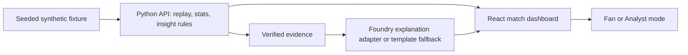

# Project plan

**Working title:** MatchLens  
**Team:** Ayesha, Maryam, Zoya, Billi  
**Planning date:** October 17, 2026  
**Official submission cutoff:** October 27, 2026 at 11:59 p.m. Pacific Time (October 28 at 12:29 p.m. India Standard Time). The team should submit earlier.

Microsoft's [official rules](https://github.com/microsoft/insidethegamehackathon/blob/main/OFFICIAL%20RULES.md) also close registration on October 20, 2026 at noon Pacific Time (October 21 at 12:30 a.m. India Standard Time). The team must appoint an eligible representative to enter the submission.

## One-sentence pitch

MatchLens turns a replayed, fictional football match into live, evidence-backed explanations that casual fans and analysts can understand at their own level.

## Problem and users

A score and raw counts show *what* happened but often leave viewers unsure *why it matters*. A casual fan wants a brief plain-language cue; an analyst wants the time window and supporting numbers. A broadcaster may want a concise fact quickly, but a broadcaster-specific UI is beyond the first release.

## MVP outcome

The team should have one public, working website with a 90-minute replay that can finish in under three minutes using playback speed/jump controls. A fixture should contain realistic fictional passes, shots, tackles, possession changes, and goals. The UI shows a live event feed and consistent score, passes, shots, and possession. It raises at least three useful insight types, shows evidence with every insight, changes wording between Fan and Analyst mode, and generates a full-time recap. A visible synthetic-data label stays on screen.

### Must have

- Deterministic, replayable synthetic match with stable event IDs and reset/pause/skip controls.
- Event-derived score and live statistics; no manually entered scoreboard values.
- Rule-based triggers for key moments, such as a goal, a recent shots imbalance, and a momentum/possession swing.
- Explanations grounded in supplied facts; Fan and Analyst variants for the same trigger.
- Evidence panel showing exact counts, window, and/or event IDs.
- End-of-match recap based on verified final statistics and selected moments.
- Local setup and public test build with a working fallback when model access fails.

### Later if time remains

- Player focus, then a second language, in that order.

### Explicitly deferred

Video event detection, tracking, real match ingestion, broadcaster integrations, accounts, and multiple cooperating AI agents. A single explanation service is enough for this demo; separate services only if there is a measured need and time to test them.

## Proposed technical path

React + TypeScript renders the dashboard. A Python API reads one versioned synthetic fixture, derives a snapshot for any requested match minute, detects insights, and serves recap facts. An explanation adapter uses Microsoft Foundry when access and deployment are confirmed; otherwise it returns clearly identified, deterministic template text. The backend never sends model credentials to the browser. The client advances the simulated clock and polls snapshots. This avoids a long-running match process or WebSocket dependency.

The precise Azure hosting setup is a day-one decision: first confirm subscription, credits, available services, and deployment rights. Prefer the simplest public deployment the team can operate. Do not build deployment around an untested service or spend credits without checking the plan. The UI and API must run locally regardless of cloud access.

## Schedule and gates

| Date | Gate | Exit evidence |
|---|---|---|
| Oct 17 | Lock MVP and owners | Name/category provisional or confirmed, repo created, API/schema agreed, Foundry/Azure access checked, deadline verified |
| Oct 18-19 | Data engine | Golden fixture, event validation, stat functions, three insight rules, tests against expected score/counts |
| Oct 20-21 | End-to-end replay | Browser calls API; events, clock, score, and stats update; reset/jump work |
| Oct 22-23 | Explanations | Fan/Analyst text for same insights, evidence panel, Foundry adapter or explicit fallback, weak-evidence case |
| Oct 24 | Full-time story | Recap and visual polish; one complete team walkthrough |
| Oct 25 | Release candidate | Tests/build pass, public URL works in private browser, defects fixed, feature freeze |
| Oct 26 | Submission assets | Video under two minutes, English pitch/readme, public repo, links and access checked |
| Oct 27 | Submit early | Submission receipt and links checked before official cutoff |

The dates above are now checked against the official rules; the daily milestones remain team targets. Keep the public demo available free of charge and without restrictions through the end of judging on November 10, 2026.

## Decision gates

1. **By Oct 17:** Confirm final name, category, official rules/deadline, repo visibility, and who controls cloud resources.
2. **By Oct 18:** Make a one-call Foundry proof of access and estimate cost. If unavailable, keep the fallback and record the limitation honestly in the pitch; seek an approved Microsoft service path before final submission.
3. **By Oct 20:** Freeze event/API shape so frontend and backend can progress in parallel.
4. **By Oct 24:** Cut optional features if the full match cannot replay cleanly end to end.
5. **By Oct 25:** Freeze features and focus on correctness, accessibility, deployment, and video.

## Risks and responses

| Risk | Early signal | Response |
|---|---|---|
| Foundry or Azure access/cost blocks integration | No successful call by Oct 18 | Keep adapter boundary and fallback; confirm permitted Microsoft option; state actual technology used |
| Model invents match facts | Text includes unsupported number, player, or event | Supply verified evidence only; reject output and use a template; display canonical evidence separately |
| Fixture and stats disagree | Score or counts fail golden test | Treat fixture as source of truth; fix parser/rules before UI polish |
| Four people block on one interface | Repeated incompatible payloads | Agree on shared schema by Oct 17, use a sample JSON response, change contract by PR |
| Deployment takes longer than expected | No public test URL by Oct 23 | Reduce services/features and deploy the smallest complete vertical slice |
| Demo depends on live model/network | Slow or failed calls during rehearsal | Cache demo fixture explanations and retain a transparent fallback |

## Judging alignment from the supplied brief

- **Technical work:** deterministic event pipeline, tested API, working public deployment, documented Microsoft integration.
- **AI design:** AI explains verified facts and adapts wording; failure and weak-evidence handling are visible.
- **Usefulness:** same insight serves fans and analysts without changing underlying truth.
- **Experience:** clear dashboard, evidence drill-down, short and reliable demo.
- **Category fit:** confirm the selected category and tailor the pitch to its actual wording.

## Open decisions to record at kickoff

| Decision | Owner | Due |
|---|---|---|
| Final project name and target category | All; Ayesha records | Oct 17 |
| Confirm registration and appoint an eligible team representative | Zoya | Before Oct 20 noon Pacific |
| Foundry model access, quota, and permitted spend | Maryam + Zoya | Oct 18 |
| Azure deployment approach and owner account | Zoya + Billi | Oct 18 |
| Final fixture teams/players and demo storyline | Billi + Ayesha | Oct 18 |

## October 24 AI delivery update

The product name is **After90**. Internal MatchLens package names remain stable.
The new twelve-phase AI delivery plan is [AI_DELIVERY.md](AI_DELIVERY.md); its
numbering is independent from the historical phases above. The approved scope
adds contextual evidence packets, paired audience generation, evaluated claim
selection, a ranked story ledger and structured studio overlay output within the
existing FastAPI/React application. Azure public release and Foundry proof remain
external gates. Optional agents and other personalization follow a stable release.

## October 25 integrated release update

Phases 7/8 now connect bounded narratives to the public API and personalized UI,
with versioned single-flight caches, failure recovery and synchronized studio
graphics. Phase 9 includes local HTTP and real browser evaluation. Phase 10 has
ARM/deploy preparation; phase 11 adds a default-disabled team-priority option.
See [IMPLEMENTATION_STATUS.md](IMPLEMENTATION_STATUS.md) for actual evidence and
external service/account/submission gates. Public Azure and real Foundry access
are not implied by local completion.

## October 27: Foundry activation and Match Copilot

User-requested extension after the core vertical slice: provision a reviewed
Foundry-compatible model deployment and add explicit, evidence-grounded viewer
questions. Match Copilot classifies a question into supported match-level topics,
then ordinary code renders recorded facts at the selected replay cutoff. It uses
the same request budget/concurrency limits as narrative selection. No live model
connection, runtime multi-agent orchestration, arbitrary factual prose, voice
service or cloud deployment is claimed until separately demonstrated.

`setup_foundry.py` prepares resource/model deployment; `connect_foundry.py` saves
private local connection settings and can run explicit live acceptance. See
FOUNDRY_SETUP.md and WINNING_UPGRADE_PLAN.md for dependency order and remaining
account-dependent gates.
